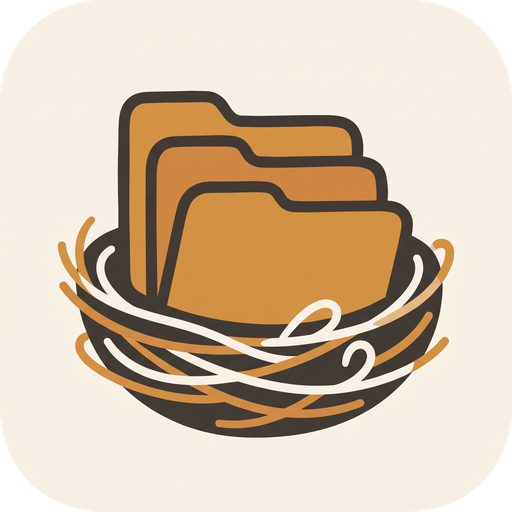
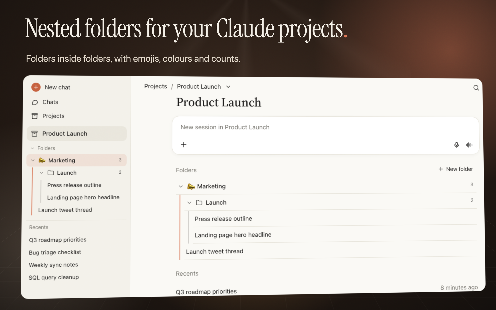
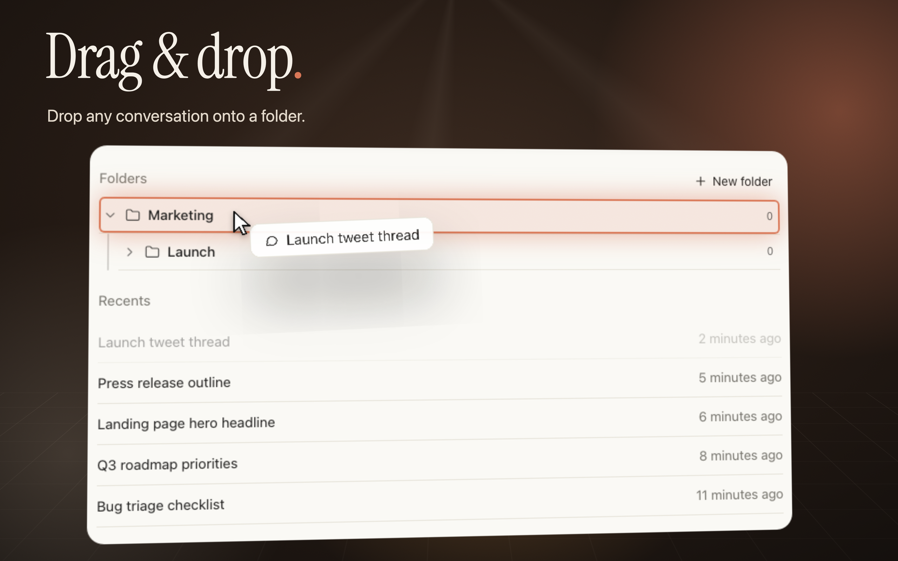
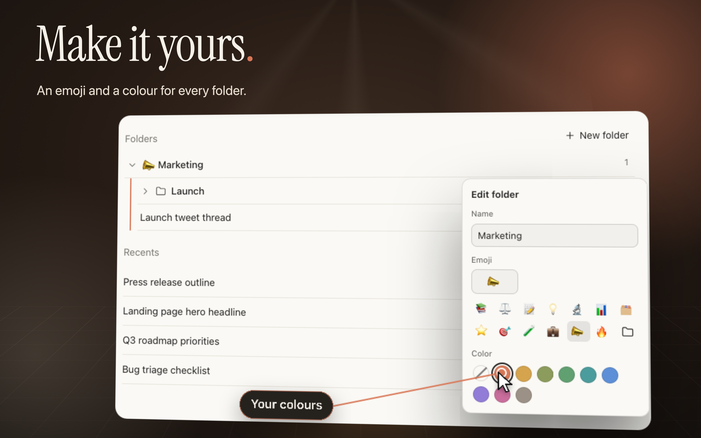
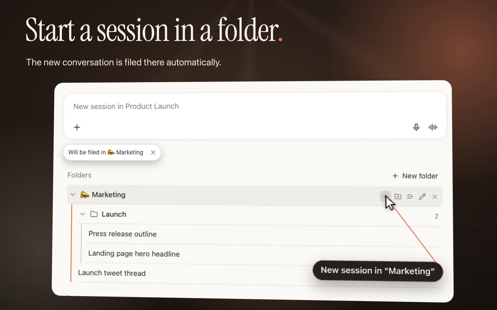
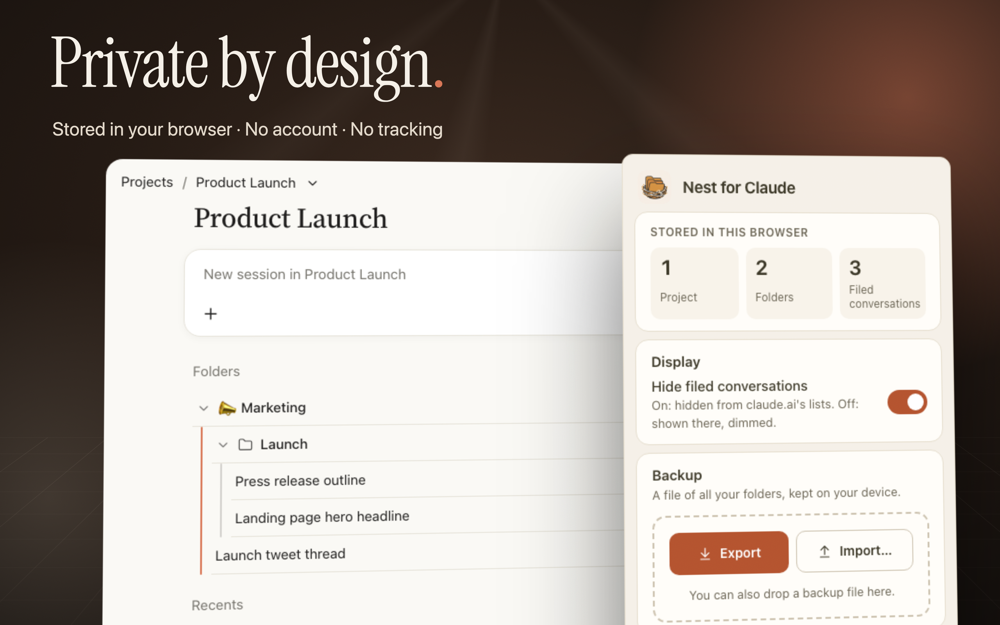

<p align="center">
  
</p>

# Nest for Claude

> Nested folders for your claude.ai conversations — organized per project, stored only in your browser.

[](https://github.com/Azurioh/nest-for-claude/actions/workflows/ci.yml)
[](LICENSE)

Nest for Claude is an open-source browser extension for Chrome and Firefox (Manifest V3) that adds
folders and sub-folders of conversations, per project, to the claude.ai sidebar and project page.

<p align="center">
  
</p>

> [!NOTE]
> Nest for Claude is an independent project. It is **not affiliated with, endorsed by or sponsored
> by Anthropic**. "Claude" is a trademark of Anthropic, PBC, used here only to describe what the
> extension works with.

## Features

- Folders and nested sub-folders of conversations, scoped to each claude.ai project, shown in the
  sidebar and on the project page.
- Drag and drop conversations and folders, or file them from the "Add conversations" panel.
- Start a new session from a folder: it is filed there as soon as you send the first message.
- Custom folder names, colours and emojis, following claude.ai's light and dark themes.
- A menu on the extension's toolbar icon (active on claude.ai only):
  - see how many projects, folders and filed conversations are stored;
  - hide filed conversations from claude.ai's lists (or just dim them);
  - backup and restore: export all your folders to a JSON file and import them back, with a full
    validation of the file and a confirmation before anything is replaced (on Firefox, backups
    open in a tab, see [#21](https://github.com/Azurioh/nest-for-claude/issues/21));
  - delete all data.
- English and French interface.
- 100% local: no account, no server, no network requests, no analytics.

<table>
  <tr>
    <td></td>
    <td></td>
  </tr>
  <tr>
    <td></td>
    <td></td>
  </tr>
</table>

## Install

Store listings (Chrome Web Store, Firefox Add-ons) are coming soon.

### From source

Requirements: [Node.js](https://nodejs.org/) (version in [`.nvmrc`](.nvmrc)) and
[pnpm](https://pnpm.io/) (version pinned in `package.json`, enable it with `corepack enable`).

```sh
git clone https://github.com/Azurioh/nest-for-claude.git
cd nest-for-claude
pnpm install
pnpm build          # Chrome  -> dist/chrome-mv3
pnpm build:firefox  # Firefox -> dist/firefox-mv3
```

- **Chrome**: open `chrome://extensions`, enable **Developer mode**, click **Load unpacked** and
  select `dist/chrome-mv3`.
- **Firefox**: open `about:debugging#/runtime/this-firefox`, click **Load Temporary Add-on** and
  select `dist/firefox-mv3/manifest.json`.

## Development quick start

```sh
pnpm install
pnpm dev            # Chrome with hot reload
pnpm dev:firefox    # Firefox with hot reload
pnpm check          # lint + typecheck + tests
```

Development builds are named **Nest for Claude (dev)** so they are easy to tell apart from a store
install. See [CONTRIBUTING.md](CONTRIBUTING.md) for all scripts and
[docs/ARCHITECTURE.md](docs/ARCHITECTURE.md) for how the code is organized.

## Privacy

- Data is stored only in your browser (`browser.storage.local`): folder names, colors, emojis, and
  the IDs and titles of the conversations you file.
- No network requests, no analytics, no third parties.
- Permissions: `storage` and access to `https://claude.ai/*` only.

Export, restore or delete your data from the menu of the extension's toolbar icon. Full details:
[PRIVACY.md](PRIVACY.md).

## Contributing

Contributions are welcome. Read [CONTRIBUTING.md](CONTRIBUTING.md) and the
[Code of Conduct](CODE_OF_CONDUCT.md). Security issues: see [SECURITY.md](SECURITY.md).

## Building the Firefox sources archive (AMO reviewers)

```sh
pnpm install
pnpm zip:firefox
```

This produces the extension zip and a sources zip in `dist/`; the build output is identical to
`pnpm build:firefox`.

## License

[MIT](LICENSE) © 2026 Alan Cunin
