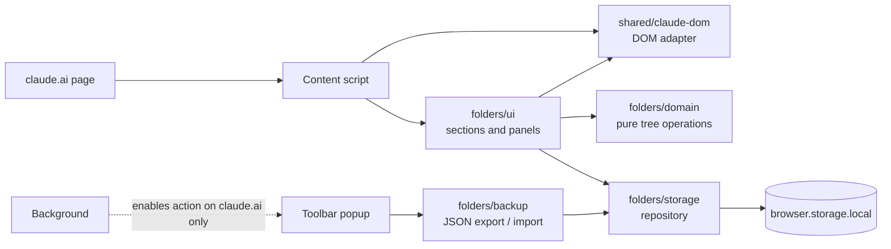

<div align="center">


<h1>Nest for Claude</h1>

<p>Nested folders for your claude.ai conversations — organized per project, stored only in your browser.</p>

</div>

<p align="center">
  <a href="#install"></a>
  <a href="#install"></a>
  <br>
  <a href="https://github.com/Azurioh/nest-for-claude/actions/workflows/ci.yml"></a>
  <a href="LICENSE"></a>
  <a href="tsconfig.json"></a>
  <a href="wxt.config.ts"></a>
  <a href="https://wxt.dev/"></a>
</p>

<p align="center">
  
</p>

> [!NOTE]
> Nest for Claude is an independent project. It is **not affiliated with, endorsed by or sponsored
> by Anthropic**. "Claude" is a trademark of Anthropic, PBC, used here only to describe what the
> extension works with.

## Why

claude.ai projects only offer a flat list of conversations, so long-running projects quickly
become hard to navigate. Nest for Claude is an open-source browser extension for Chrome and
Firefox (Manifest V3) that adds folders and sub-folders of conversations, per project, to the
claude.ai sidebar and project page. Everything stays in your browser: no account, no server, no
network requests.

## Features

- **Nested folders**: folders and sub-folders of conversations, as deep as needed, scoped to each
  claude.ai project.
- **In place**: folders are shown in the claude.ai sidebar and on the project page, and follow
  claude.ai's light and dark themes.
- **New session in a folder**: start a session from a folder; it is filed there as soon as the
  first message is sent.
- **Drag and drop**: move conversations and folders, or file conversations from the "Add
  conversations" panel.
- **Appearance**: custom folder names, colors and emojis.
- **Toolbar menu** (enabled on claude.ai tabs only):
  - see how many projects, folders and filed conversations are stored;
  - hide filed conversations from claude.ai's lists (or just dim them);
  - backup and restore: export all your folders to a JSON file and import them back, with a full
    validation of the file and a confirmation before anything is replaced (on Firefox, backups
    open in a tab, see [#21](https://github.com/Azurioh/nest-for-claude/issues/21));
  - delete all data.
- **Languages**: English and French interface.
- **Local only**: no account, no server, no network requests, no analytics.

<table>
  <tr>
    <td></td>
    <td></td>
  </tr>
  <tr>
    <td></td>
    <td></td>
  </tr>
</table>

## See it in action

https://github.com/user-attachments/assets/3915f090-7c6d-4de6-9696-ad6ee1746edf

## Install

Store listings (Chrome Web Store, Firefox Add-ons) are coming soon.

### From source

Requirements: [Node.js](https://nodejs.org/) (version in [`.nvmrc`](.nvmrc)) and
[pnpm](https://pnpm.io/) (version pinned in `package.json`, enable it with `corepack enable`).

```sh
git clone https://github.com/Azurioh/nest-for-claude.git
cd nest-for-claude
pnpm install
pnpm build          # Chrome  -> dist/chrome-mv3
pnpm build:firefox  # Firefox -> dist/firefox-mv3
```

- **Chrome**: open `chrome://extensions`, enable **Developer mode**, click **Load unpacked** and
  select `dist/chrome-mv3`.
- **Firefox**: open `about:debugging#/runtime/this-firefox`, click **Load Temporary Add-on** and
  select `dist/firefox-mv3/manifest.json`.

## Usage

1. Open a project on [claude.ai](https://claude.ai). A folders section appears above the project
   page's "Recents" list and at the top of the expanded project in the sidebar.
2. Click **New folder** to create a folder. Hover or focus a folder row to reveal its actions: new
   session in this folder (`+`), new sub-folder, add conversations, edit (name, emoji, color) and
   delete.
3. Drag a conversation onto a folder to file it, or drag a folder onto another one to nest it. Drop
   onto a section header to move a folder to the top level or take a conversation out of its
   folder.
4. Click the extension's toolbar icon on a claude.ai tab to see stored counts, toggle hiding of
   filed conversations, export or import a backup, or delete all data.

## How it works



- The content script runs on `https://claude.ai/*`. `shared/claude-dom` is the only code that
  knows claude.ai's DOM (selectors, sidebar and "Recents" detection, title extraction), tested
  against HTML fixtures.
- The UI loads the folder tree of each displayed project from storage, renders it next to
  claude.ai's own lists, and sends user actions through a pure domain operation, then a save.
  Floating panels render in a Shadow DOM so claude.ai's styles and the extension's do not collide.
- Storage uses one `browser.storage.local` key per project, versioned and validated on load; other
  tabs re-render on changes.

Full details: [docs/ARCHITECTURE.md](docs/ARCHITECTURE.md).

### Privacy and permissions

- Data is stored only in your browser (`browser.storage.local`): folder names, colors, emojis, and
  the IDs and titles of the conversations you file.
- No network requests, no analytics, no third parties.
- Permissions: `storage` and access to `https://claude.ai/*` only.

Export, restore or delete your data from the menu of the extension's toolbar icon. Full details:
[PRIVACY.md](PRIVACY.md).

## Project structure

```
src/
  entrypoints/              # background, claude.ai content script, toolbar popup, Firefox backup page
  features/folders/
    domain/                 # pure TS folder tree operations and ports, no DOM, no browser APIs
    storage/                # repository over browser.storage, versioned schema and validation
    ids/                    # folder id provider (crypto.randomUUID)
    backup/                 # backup file format: serialization, Zod validation, size-checked reading
    ui/                     # folder sections, drag and drop and floating panels on claude.ai
    popup/                  # toolbar popup and backup page
  features/toolbar-action/  # keeps the toolbar action enabled on claude.ai tabs only
  shared/claude-dom/        # the only code that knows claude.ai's DOM
  locales/                  # en.yml, fr.yml
tests/                      # Vitest suites mirroring src/, plus sanitized claude.ai HTML fixtures
docs/                       # architecture, store listing, brand and store assets
```

## Development

```sh
pnpm install
pnpm dev            # Chrome with hot reload
pnpm dev:firefox    # Firefox with hot reload
pnpm lint           # Biome
pnpm typecheck      # wxt prepare + tsc --noEmit
pnpm test           # Vitest
pnpm check          # lint + typecheck + tests
```

Development builds are named **Nest for Claude (dev)** so they are easy to tell apart from a store
install. See [CONTRIBUTING.md](CONTRIBUTING.md) for all scripts and
[docs/ARCHITECTURE.md](docs/ARCHITECTURE.md) for how the code is organized.

### Firefox sources archive (AMO reviewers)

```sh
pnpm install
pnpm zip:firefox
```

This produces the extension zip and a sources zip in `dist/`; the build output is identical to
`pnpm build:firefox`.

## Contributing

Contributions are welcome. Read [CONTRIBUTING.md](CONTRIBUTING.md) and the
[Code of Conduct](CODE_OF_CONDUCT.md). Security issues: see [SECURITY.md](SECURITY.md).

## License

[MIT](LICENSE) © 2026 Alan Cunin
